# Linux Administration and Bash Scripting Portfolio

Welcome to my DevOps repository! This documentation outlines various Linux administration tasks, file permission controls, user management, and Bash scripting exercises.

## 1. User and Group Management

Managing users, groups, and permissions to control access within the Linux system.

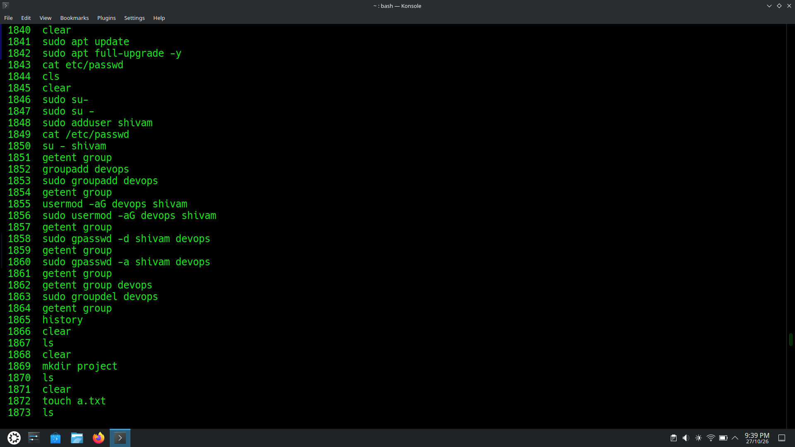

### Key Commands:
```bash
sudo adduser shivam
sudo addgroup devops
sudo usermod -aG devops shivam
sudo gpasswd -d shivam devops
```

---

## 2. Advanced User Operations

Further verification of group permissions and user switching.

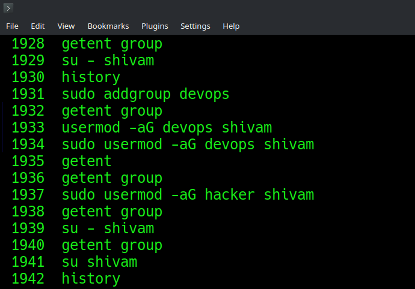

### Key Commands:
```bash
su - shivam
sudo gpasswd -a shivam devops
getent group
```

---

## 3. File Management and Permissions

Creating files, directories, and modifying access permissions using `chmod`.

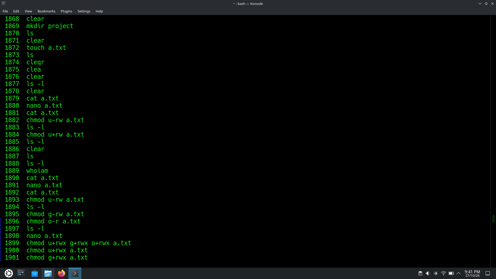

### Key Commands:
```bash
mkdir project
touch a.txt
chmod u+rw a.txt
ls -l
```

---

## 4. Directory & File Access Control

Modifying permissions for users, groups, and others on files and directories.

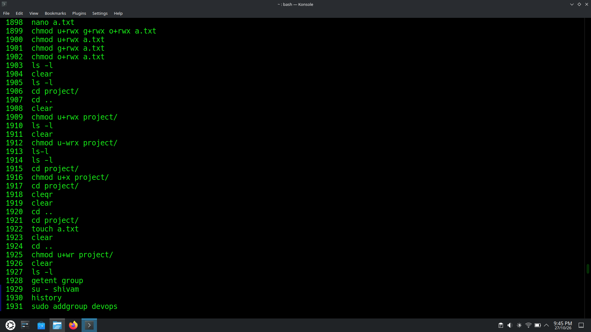

### Key Commands:
```bash
cd project/
chmod u+rwx g+rwx o+rwx a.txt
chmod u+x project/
```

---

## 5. Shell Scripting Basics

Writing, granting permissions, and executing custom shell scripts.

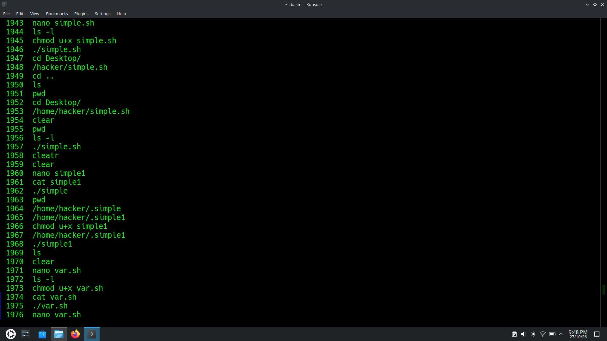

### Key Commands:
```bash
nano simple.sh
chmod u+x simple.sh
./simple.sh
```

---

## 6. Variables and Operations

Working with variables, operational logic, and executing scripts from different paths.

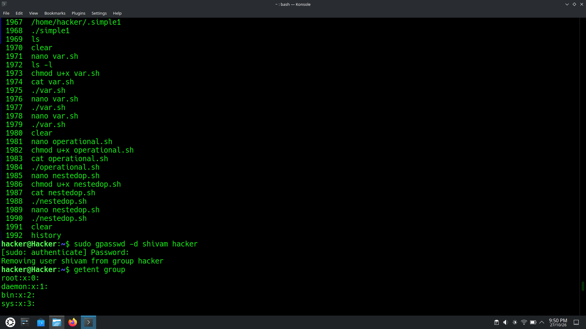

### Key Commands:
```bash
nano var.sh
chmod u+x var.sh
./var.sh
```
---
## 7. Git Introduction and Setup

Initializing repositories, configuring user settings, committing files, and linking to remote repositories.

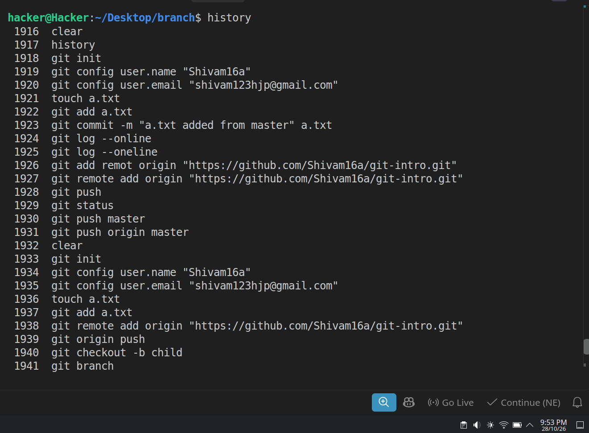

### Key Commands:
```bash
git init
git config user.name "Shivam16a"
git config user.email "shivam123hjp@gmail.com"
touch a.txt
git add a.txt
git commit -m "a.txt added from master" a.txt
git remote add origin "https://github.com/Shivam16a/git-intro.git"
git push -u origin master
```

---

## 8. Git Branching

Creating, switching between, and managing multiple feature or child branches in Git.

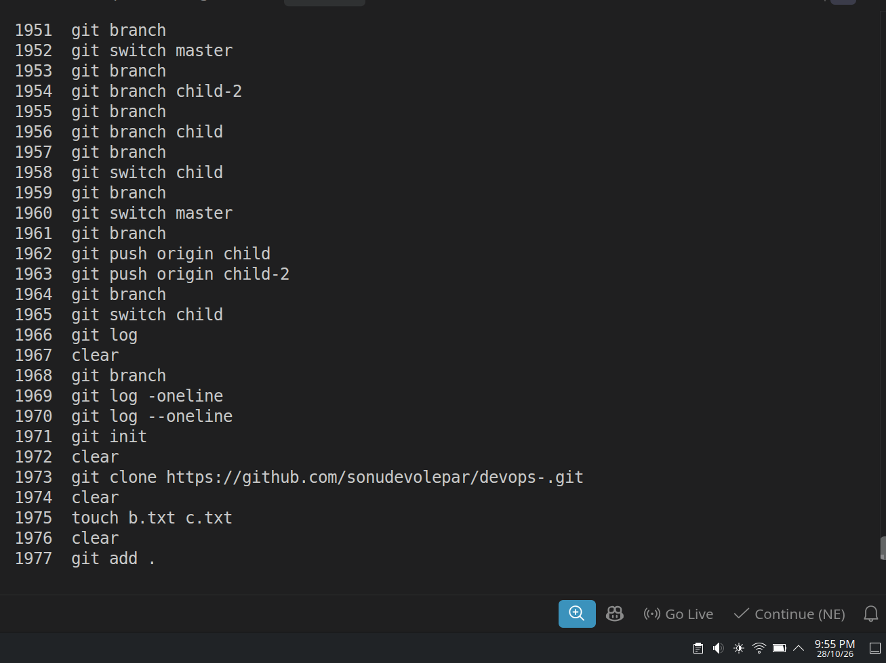

### Key Commands:
```bash
git branch
git checkout -b child
git switch master
git branch child-2
git push origin child
git push origin child-2
```

---

## 9. Git Reset Operations

Managing commit history and staging areas using soft, mixed, and hard resets.

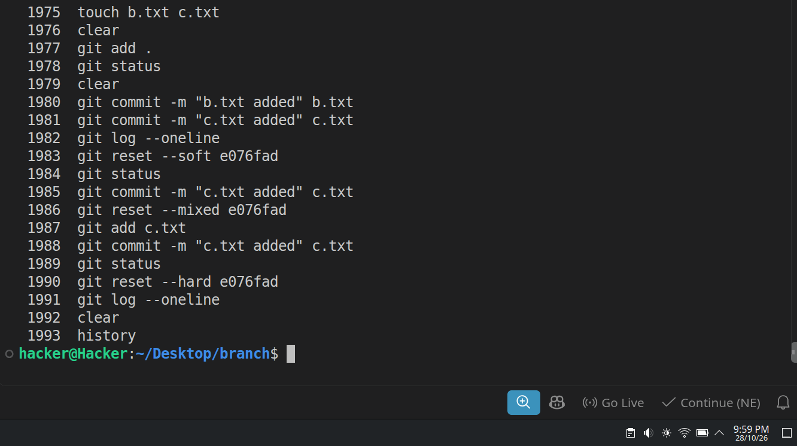

### Key Commands:
```bash
git log --oneline
git reset --soft e076fad
git reset --mixed e076fad
git reset --hard e076fad
```

---

## 10. Git Merging - Part 1

Merging feature branches into the master branch and tracking the version history.

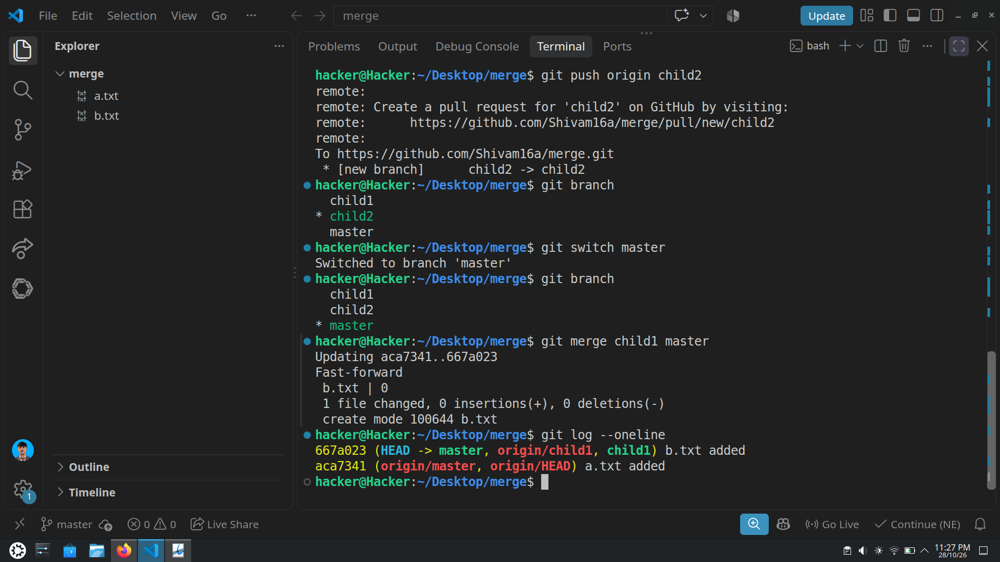

### Key Commands:
```bash
git switch master
git merge child1 master
git log --oneline
```

---

## 11. Git Merging - Part 2

Workflow demonstrating multi-branch creation, commits, pushes, and fast-forward merging.

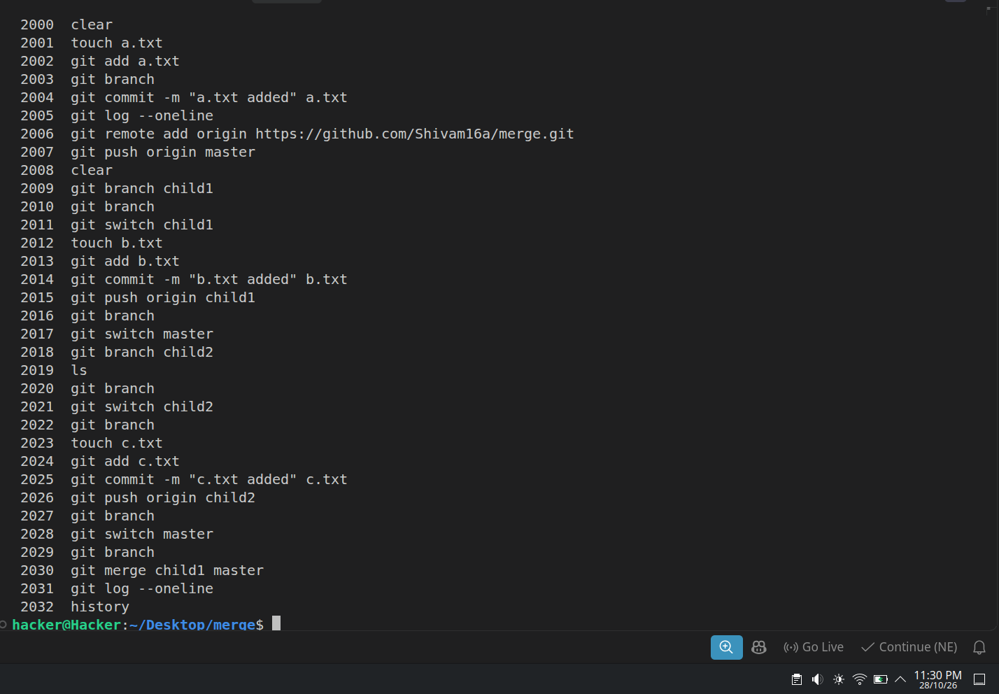

### Key Commands:
```bash
git branch child1
git switch child1
touch b.txt
git add b.txt
git commit -m "b.txt added" b.txt
git push origin child1
```

---

## Author

**Shivam Kumar**  
GitHub: [@Shivam16a](https://github.com/Shivam16a)